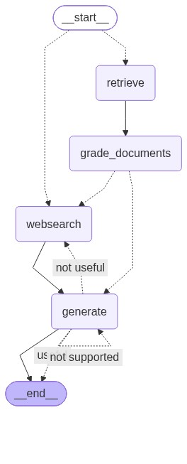

# LangGraph Adaptive & Corrective RAG (CRAG) Agent

Bu proje, LangGraph mimarisi kullanılarak geliştirilmiş otonom ve kendini düzelten bir Adaptive & Corrective RAG (CRAG) sistemidir.

Geleneksel RAG yapılarının aksine bu mimari; sorgunun türünü dinamik olarak analiz eder (routing), vektör veritabanından çekilen dokümanların alaka düzeyini puanlar (document grading), dokümanlar yetersiz kaldığında otomatik olarak web aramasıyla (fallback web search) bağlamı genişletir ve üretilen cevabın halüsinasyon içerip içermediğini denetler.

---

## Mimari Akis Diyagrami

Projenin durum makinesi (StateGraph) asagidaki akisa gore calismaktadir:



### Akis Asamalari:
1. **Router:** Kullanici sorusu analiz edilir. Soru vektor veritabanindaki dokumanlarla ilgiliyse retrieve dugumune, degilse dogrudan web_search dugumune yonlendirilir.
2. **Retrieve:** Vektor veritabanindan en alakali dokuman parcalari cekilir.
3. **Grade Documents:** Cekilen dokumanlar tek tek LLM tarafindan filtrelenir. Alakasiz olanlar elenir. Yeterli bilgi kalmazsa web_search bayragi aktif edilir.
4. **Web Search:** Eksik ya da yetersiz kalan baglam Tavily Search API araciligiyla internetten taranarak guncellenir.
5. **Generate:** Dogrulanmis baglam kullanilarak nihai yanit uretilir.
6. **Hallucination & Answer Grading:**
   - Uretilen yanit dokumanlara dayaniyor mu? (Hallucination check)
   - Uretilen yanit kullanicinin asil sorusunu eksiksiz cevapliyor mu? (Answer quality check)
   - Sartlar saglanmazsa surec kendini otomatik olarak revize eder veya sonlandirir.

---

## Proje Yapisi

```text
.
├── graph/
│   ├── chains/
│   │   ├── answer_grader.py        # Cevabin soruya uygunlugunu denetleyen chain
│   │   ├── generation.py           # Nihai cevabi ureten LLM chain
│   │   ├── hallucination_grader.py # Halusinasyon denetimi yapan chain
│   │   ├── retrieval_grader.py     # Dokuman alaka duzeyini puanlayan chain
│   │   └── router.py               # Vektor DB / Web Search yonlendirme zinciri
│   ├── nodes/
│   │   ├── generate.py             # Cevap uretim dugumu
│   │   ├── grade_documents.py      # Dokuman filtreleme dugumu
│   │   ├── retrieve.py             # Dokuman getirme dugumu
│   │   └── web_search.py           # Web arama dugumu
│   ├── graph.py                    # StateGraph yapisi ve conditional edge tanimlari
│   ├── node_constants.py           # Node isim sabitleri
│   └── state.py                    # GraphState veri modeli
├── ingestion.py                    # Dokuman yukleme, chunking ve vektor DB indeksi
├── main.py                         # Graph calistirma ve test giris noktasi
├── requirements.txt                # Bagimliliklar
└── .gitignore
